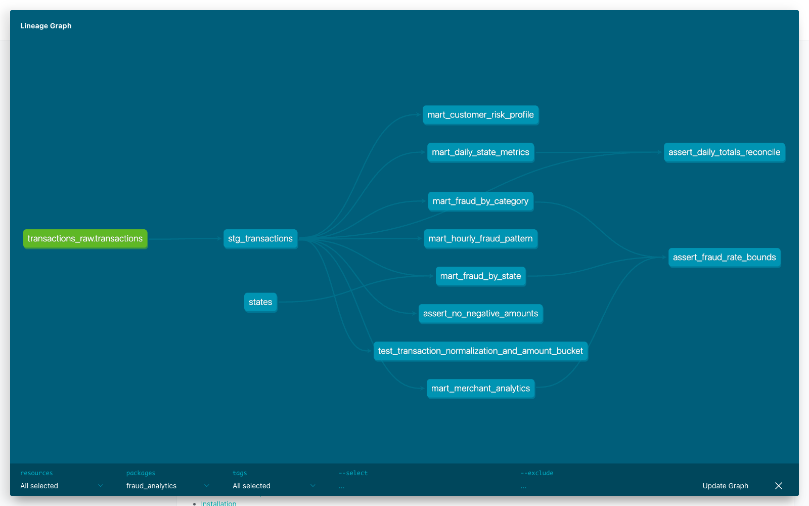

# dbt ClickHouse Fraud Analytics

Репозиторий содержит решение домашней работы по dbt: исходные транзакции хранятся в ClickHouse, преобразуются в staging-модель и используются для построения шести аналитических витрин.

## Архитектура

```text
CSV -> ClickHouse source -> stg_transactions -> marts
                                             -> data tests
                                             -> dbt Docs
```

Компоненты:

1. `transactions_db.transactions` хранит исходные транзакции, загруженные из CSV.
2. `stg_transactions` нормализует значения, создает идентификаторы и вычисляемые признаки.
3. Модели `mart_*` формируют витрины по штатам, категориям, клиентам, времени и мерчантам.
4. `dbt-build` устанавливает пакеты, загружает seed, выполняет модели и тесты, затем генерирует документацию.
5. `dbt-docs` публикует каталог моделей и граф зависимостей.

## Требования

- Docker 20.10 или новее;
- Docker Compose 2.0 или новее;
- Python 3.12 для локального запуска pre-commit hooks.

## Быстрый запуск

Скопируйте настройки окружения:

```bash
cp .env.example .env
```

Соберите и запустите проект:

```bash
docker compose up -d --build
docker compose ps -a
```

Контейнер `dbt-build` должен завершиться со статусом `Exited (0)`, а `clickhouse` и `dbt-docs` остаться запущенными.

Интерфейсы:

- dbt Docs: http://localhost:8080;
- HTTP-интерфейс ClickHouse: http://localhost:8123;
- native protocol ClickHouse: `localhost:9000`.

## Данные

В проект входит выборка `data/transactions.csv` из 5000 транзакций. При первом запуске ClickHouse создает таблицу `transactions_db.transactions` и загружает файл.

Для запуска на другом CSV замените `data/transactions.csv`, затем пересоздайте образ и volume:

```bash
docker compose down -v
docker compose up -d --build
```

Файл должен содержать поля исходного датасета в том же порядке, что и таблица из `clickhouse/init/01_transactions.sql`.

## Проверка результата

Посмотреть итог последнего запуска dbt:

```bash
docker compose logs dbt-build
```

Выполнить полный цикл повторно:

```bash
docker compose --profile tools run --rm dbt build
```

Проверить количество исходных и обработанных транзакций:

```bash
docker compose exec clickhouse clickhouse-client \
  --user pipeline_user --password pipeline_password \
  --query "SELECT count() FROM transactions_db.transactions"

docker compose exec clickhouse clickhouse-client \
  --user pipeline_user --password pipeline_password \
  --query "SELECT count() FROM analytics.stg_transactions"
```

Получить штаты с наибольшей долей мошеннических транзакций:

```bash
docker compose exec clickhouse clickhouse-client \
  --user pipeline_user --password pipeline_password \
  --query "SELECT * FROM analytics.mart_fraud_by_state ORDER BY fraud_rate DESC LIMIT 10 FORMAT PrettyCompact"
```

## Модели

Staging-слой:

- `stg_transactions` приводит категории и коды штатов к единому регистру, формирует технические идентификаторы, календарные признаки, расстояние до мерчанта и сегмент суммы.

Витрины:

- `mart_daily_state_metrics` - дневное число транзакций, оборот, средняя сумма, P95 и доля крупных операций по штатам;
- `mart_fraud_by_category` - частота и сумма мошеннических операций по категориям;
- `mart_fraud_by_state` - показатели мошенничества по штатам со справочником названий и регионов;
- `mart_customer_risk_profile` - активность и уровень риска клиента;
- `mart_hourly_fraud_pattern` - распределение операций по дням недели и часам;
- `mart_merchant_analytics` - оборот, аудитория и признак повышенного риска мерчанта.

## Макросы и пакеты

Собственные макросы:

- `amount_bucket` распределяет транзакции по диапазонам суммы;
- `customer_risk_level` определяет уровень риска клиента;
- ClickHouse dispatch-макросы обеспечивают работу календарных функций `dbt_date`.

Подключенные пакеты:

- `dbt_utils` используется для технических идентификаторов и составных проверок уникальности;
- `dbt_date` используется для календарных признаков;
- `dbt_expectations` используется для проверки диапазона суммы.

## Тесты

`dbt build` выполняет generic-тесты, три singular-теста и unit test staging-модели. Проверяются обязательные поля, уникальность ключей, допустимые значения, диапазоны показателей и согласованность агрегатов.

Запустить только тесты:

```bash
docker compose --profile tools run --rm dbt test
```

Запустить unit tests:

```bash
docker compose --profile tools run --rm dbt test --select test_type:unit
```

Проверить SQL-код:

```bash
make lint
```

Установить и запустить локальные pre-commit hooks:

```bash
python3.12 -m pip install -r requirements.txt
pre-commit install
pre-commit run --all-files
```

## Документация

Документация создается командой `dbt docs generate` внутри `dbt-build` и публикуется сервисом `dbt-docs`.

Граф зависимостей контрольного запуска:



## Makefile

Основные команды:

```bash
make up
make build
make run
make test
make docs
make lint
make down
```

## Структура проекта

```text
.
├── artifacts/
│   └── dbt_docs_dag.png
├── clickhouse/
│   ├── init/
│   │   └── 01_transactions.sql
│   └── Dockerfile
├── data/
│   └── transactions.csv
├── dbt/
│   ├── macros/
│   ├── models/
│   │   ├── marts/
│   │   ├── sources/
│   │   └── staging/
│   ├── seeds/
│   ├── tests/
│   ├── dbt_project.yml
│   ├── packages.yml
│   └── profiles.yml
├── docker/dbt/Dockerfile
├── .pre-commit-config.yaml
├── .sqlfluff
├── docker-compose.yml
├── Makefile
├── requirements.txt
└── README.md
```

## Остановка

Остановить контейнеры:

```bash
docker compose down
```

Удалить контейнеры вместе с данными ClickHouse и артефактами dbt:

```bash
docker compose down -v
```
